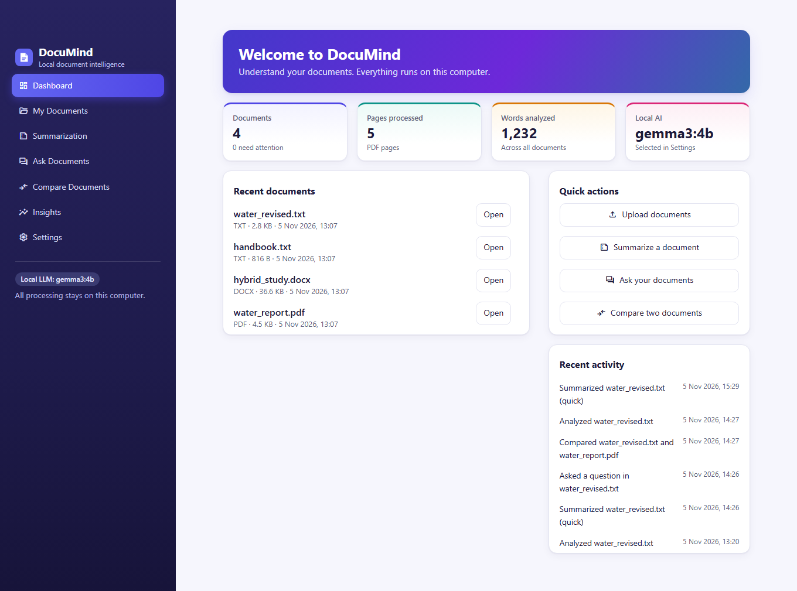

# DocuMind – Intelligent Document Understanding System

DocuMind is a standalone application for understanding documents. Upload PDF, Word or text files, then summarize them, ask questions, extract key information and compare them. All AI processing runs on your own computer, so it needs no API keys or cloud accounts, and your documents are never uploaded anywhere.



## Project overview

DocuMind reads your documents, builds a local search index and answers from what the documents actually say. Every answer shows its sources and page numbers. If no evidence exists, it says so rather than guessing.

It works in two modes:

- **Local LLM mode**, which uses a model running on your computer through [Ollama](https://ollama.com).
- **Extractive mode**, which needs no LLM and copies the most relevant sentences from your documents.

Every result states which mode produced it.

## Problem statement

Long documents take time to read, and useful facts are easy to miss. Online AI tools can help, but they send your documents to someone else's servers, which rules them out for confidential reports, contracts and research. They can also state things the document never said, with nothing to show where a claim came from.

## Objectives

- Summarize, search and compare documents without any cloud service.
- Base every answer on evidence and show where it came from.
- Say clearly when the evidence is not there.
- Remain useful on an ordinary laptop, with or without a local LLM.

## Main features

- **Upload:** PDF, DOCX and TXT files, with validation, duplicate detection and clear messages for damaged, password-protected or scanned files.
- **Summaries:** quick, detailed and executive summaries, including long documents.
- **Document chat:** questions answered from your documents, with citations, page numbers and supporting text.
- **Comparison:** similarity scores, shared and unique topics, differing statements and figures, passages found in only one document, and a side-by-side view.
- **Insights:** themes, names, dates, figures, important sections, conclusions, possible action items and document statistics.
- **Charts:** keyword frequency, topic distribution, keyword comparison and a similarity heat map.
- **Exports:** summaries as TXT or Markdown, keywords as CSV, comparisons as PDF and insights as JSON.

## Technology stack

| Purpose | Technology |
| --- | --- |
| Language | Python 3.12 |
| Interface | Streamlit and Plotly |
| Reading documents | PyMuPDF and python-docx |
| Embeddings | Sentence Transformers (`all-MiniLM-L6-v2`) |
| Vector search | FAISS, with a NumPy fallback |
| Keywords and topics | scikit-learn (TF-IDF and NMF) |
| Local LLM (optional) | Ollama |
| Storage | SQLite and local files |
| PDF reports | ReportLab |

## System architecture

The code has four layers, and dependencies only point downward:

```
ui/         Streamlit pages. Display and input only.
  │
core/       Document processing, retrieval and AI logic. Never imports Streamlit.
  │
database/   SQLite metadata: documents, chunks, chat history.
  │
utils/      Pure helpers. Imports nothing from the layers above.

config.py   Every setting. Any layer may import it.
```

### Modules

| Module | Responsibility |
| --- | --- |
| `core/document_loader.py` | Extract text and structure from PDF (PyMuPDF), DOCX and TXT, keeping page numbers |
| `core/text_cleaner.py` | Normalize whitespace, control characters and paragraphs |
| `core/ingestion.py` | Run an upload through validation, storage, extraction and metadata recording |
| `core/chunker.py` | Split text into sentence-aligned, overlapping chunks and smaller search passages |
| `core/embedding_engine.py` | Load the embedding model once; embed chunks and queries |
| `core/vector_store.py` | Own the FAISS index and NumPy fallback: add, remove, search, persist |
| `core/indexing.py` | Keep chunks, embeddings, SQLite and the index in step; repair them at startup |
| `core/retriever.py` | Turn a query into ranked chunks, with document filtering and a relevance floor |
| `core/keyword_extractor.py` | TF-IDF keywords and keyphrases; NMF topics |
| `core/ollama_client.py` | Talk to the local Ollama service: status, model list, generation |
| `core/summarizer.py` | Quick, detailed and executive summaries, by LLM or extractive fallback |
| `core/question_answering.py` | Evidence-grounded answers with citations, or an explicit refusal |
| `core/document_comparator.py` | Semantic, lexical and numeric comparison of two documents |
| `core/insights.py` | Names, dates, figures, themes, conclusions and document statistics |
| `core/exporter.py` | CSV, JSON and PDF exports, kept local |
| `database/schema.py` | Table definitions and schema version |
| `database/db_manager.py` | Connections, migrations and all metadata reads and writes |
| `ui/*.py` | One module per page, plus shared `components.py` and `charts.py` |
| `assets/styles.css` | Interface styles. Theme colors and fonts are in `.streamlit/config.toml` |
| `utils/file_validation.py` | Extension, size and file signature checks; safe storage paths |
| `utils/text_utils.py` | Sentence splitting and token estimation |
| `utils/logging_config.py` | Rotating local log files |
| `utils/helpers.py` | Hashing, IDs and formatting |

### Data flow

**Ingestion**

```
upload → validate → SHA-256 duplicate check → store file → extract → clean → mark "ready"
       → chunk → embed passages → record in SQLite → add to FAISS → mark "indexed"
```

**Question answering**

```
question → embed → FAISS passages → drop results below the relevance floor → group by chunk
  ├─ no evidence left    → "not enough evidence in the document"
  ├─ Ollama available    → grounded prompt → answer + citations   (labelled LLM)
  └─ Ollama unavailable  → best-matching sentences + citations    (labelled extractive)
```

### Storage

| Data | Location | Notes |
| --- | --- | --- |
| Original files | `uploads/` | Stored under the document ID, never the user's filename |
| Extracted text, chunks, embeddings | `processed/<document_id>/` | JSON and NumPy `.npy`, no pickle |
| Vector index | `indexes/` | Derived data, rebuilt from `processed/` when needed |
| Metadata and chat history | `documind.db` | SQLite; holds no full document text |

**SQLite is the source of truth; FAISS is a rebuildable cache.** Each vector has an integer ID from the `vectors` table, which is never reused, and is held in an `IndexIDMap2` over `IndexFlatIP`. That index is exact, equals cosine similarity on normalized vectors, and supports deletion. Files are written first, then SQLite commits, then the index updates and is replaced atomically. At startup any difference between the index and SQLite is repaired from the stored embeddings, without loading the model.

A document whose text was extracted but could not be indexed, for example because the embedding model is not downloaded yet, stays `ready` with its search status `pending`, and can be indexed later.

### Key design decisions

- **Data stays out of cloud-synced folders.** If the project is inside OneDrive, Dropbox, Google Drive or iCloud, data is stored in `%LOCALAPPDATA%\DocuMind\data` instead of `data/`. Sync clients would otherwise upload documents to their servers and can corrupt a live SQLite file. Set `DOCUMIND_DATA_DIR` to choose a different location.
- **Search runs over passages, not whole chunks.** `all-MiniLM-L6-v2` reads at most 256 tokens, and one vector for a 500-token chunk blurs together every subject in it. Each chunk is therefore split into passages of about 128 tokens with a vector each. A search matches passages and returns their parent chunks, so the LLM still gets the full context. In testing this took right-document retrieval from 13 of 14 questions to 14 of 14.
- **Chunks never cross a page.** A chunk's page number is therefore always exact, at the cost of smaller chunks on short pages.
- **The relevance floor is measured, not guessed.** On 28 test questions, relevant passages scored at least 0.28 and unrelated ones at most 0.19, so `min_similarity` is 0.25. Results below it are dropped, never shown as weak matches.
- **Answers are checked, not trusted.** Small models do not follow rules reliably, so nothing rests on the prompt alone. The model is not called when retrieval finds no evidence. Text that looks like instructions is removed before the prompt is built. Afterwards, invented citations are removed and unsupported figures and wording are flagged. Every answer and summary states whether an LLM wrote it or sentences were copied.
- **Thinking is requested, then thrown away.** `qwen3:4b` ignores `think: false` and writes its reasoning into the reply. With `think: true`, Ollama returns that reasoning in a separate field that DocuMind never uses, so `thinking_tokens` adds room for it to the output limit.
- **Long documents are summarized in parts.** Each part fits one prompt, the notes are merged in rounds if needed, and sections missing from a cut-off reply are reported.
- **Comparison scores are separate calculations.** Semantic is the cosine similarity of each passage's best match, averaged in both directions. Lexical is TF-IDF cosine similarity. Exact wording is the Jaccard overlap of five-word sequences. Overall is 70% semantic and 30% lexical. None of them says whether a document is correct.
- **Comparison thresholds are measured.** On test documents, the same text scored 1.00, a revised copy 0.96, a reworded summary 0.37 and unrelated documents 0.12 to 0.16. No passage from an unrelated document scored above 0.41, so `unique_passage_threshold` is 0.50.
- **Statements are paired with their figures hidden.** Sentences that differ only in a number therefore pair up as one statement and are reported as a numeric difference. Stop words are kept here, because "not" can reverse a statement.
- **Topic presence comes from terms, not chunks.** The same text splits differently as a PDF and a TXT, so a topic counts as present in a document when most of its terms appear there.
- **Stored embeddings are reused.** Comparison reads each document's saved vectors and never embeds a document again.
- **Exports are hardened.** CSV cells that a spreadsheet would run as formulas are neutralized, and document text is escaped before it reaches the PDF builder.
- **Broad questions have their own path.** "What are the main findings?" shares few words with any passage, so it can score below the relevance floor even when the document answers it. A question made only of document-structure words therefore uses the closest passages, and the answer says so. Any subject word keeps the normal floor.
- **The browser never contacts another server.** Document and model text can contain Markdown images, and a browser would fetch them from their URL, which could carry document text away. All such text is sanitized or escaped, and HTML stays on one line, because a blank line would end the HTML block and turn the rest into Markdown. Fonts are system fonts, and the page icon is a local file because Streamlit fetches its Material and emoji icons from the web. A headless browser run through every page recorded no outside requests.
- **Ollama is restricted to loopback.** `config.py` rejects any Ollama URL that does not point at this machine.
- **Streamlit telemetry is off** and the server binds to `localhost` (see `.streamlit/config.toml`).

## Folder structure

```
DocuMind/
├── app.py                 Entry point, navigation and page routing
├── run.bat                Windows startup script
├── config.py              Settings and environment overrides
├── requirements.txt       Runtime packages
├── requirements-dev.txt   Test packages
├── .streamlit/            Theme and server settings
├── assets/                Styles, icon and screenshots
├── core/                  Document processing and AI logic
├── database/              SQLite schema and access
├── ui/                    One module per page, plus shared components and charts
├── utils/                 Validation, text helpers and logging
├── tests/                 Automated tests
└── data/                  Your documents and indexes (not tracked by git)
```

## Performance

Two 1,000-page PDFs (720,000 words in total) on the development laptop, with the real embedding model:

| Operation | Result |
| --- | --- |
| Upload and index one document | About 65 s, or about 5,500 words per second |
| Search | About 27 ms per question |
| Compare the two documents | About 20 s |
| Insights | About 8 s |
| Startup check of the index | 0.03 s |
| Peak memory | 1.44 GB, not counting Ollama |

At that rate, a file holding millions of words takes tens of minutes to index, and the page waits while it does.

## Known limits

- **Prompt injection cannot be fully prevented.** Text that looks like instructions is removed and the rules are repeated after the sources. In testing, answers resisted 23 of 24 attacks across three models. The failure was a false "correction" written as ordinary content, which a filter cannot tell from a real statement. Sources are always shown next to the answer so this can be checked.
- **Comparison reads sentences**, so a changed figure inside a table is not reported as a numeric difference.
- **Names, dates and figures come from patterns**, not a trained model, and spelled-out numbers are not matched to digits.
- **Scanned PDFs need OCR first.** DocuMind detects them and says so, but does not run OCR.
- **Stop words and thresholds are tuned on English test documents**, so other languages get weaker results.

## Configuration

Settings live in `config.py`. These environment variables override them:

| Variable | Default |
| --- | --- |
| `DOCUMIND_DATA_DIR` | `data/`, or `%LOCALAPPDATA%\DocuMind\data` in a cloud-synced folder |
| `DOCUMIND_MAX_FILE_SIZE_MB` | `50` (also change `maxUploadSize` in `.streamlit/config.toml`) |
| `DOCUMIND_EMBEDDING_MODEL` | `sentence-transformers/all-MiniLM-L6-v2` |
| `DOCUMIND_OLLAMA_URL` | `http://localhost:11434` (loopback only) |
| `DOCUMIND_OLLAMA_MODEL` | `qwen2.5:3b` |
